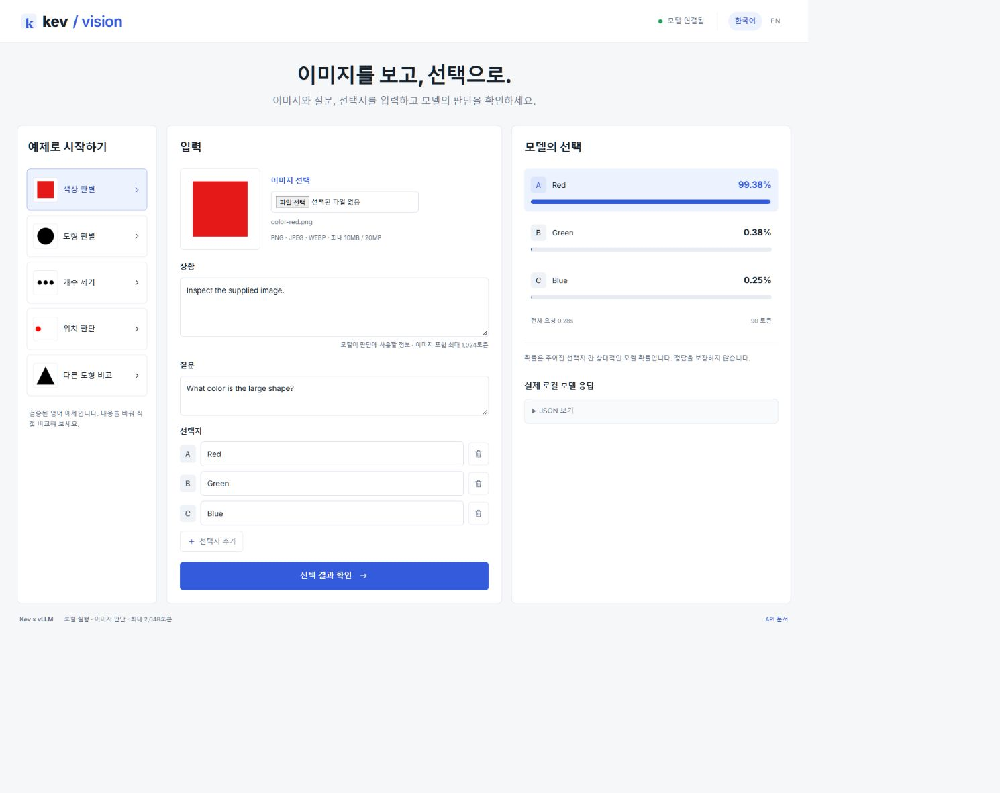

# kev-vision

[English](README.md) | **한국어**

이미지·상황·질문·선택지를 입력하면 각 선택지의 확률과 선택 결과를 반환하는 비공식 실험용 vLLM 플러그인입니다. 자유로운 채팅 응답을 생성하지 않습니다. Qwen3.5 비전 인코더와 Kev 언어 가중치·판단 헤드를 추가 학습 없이 결합합니다.

## 웹 화면으로 체험하기



설치 후 **`run_vision.bat`를 더블클릭**하면 모델을 한 번 로딩한 뒤
<http://127.0.0.1:18092> 화면을 엽니다. 예제 이미지를 고르거나 PNG/JPEG/WEBP
파일을 업로드하고, 질문·선택지를 수정해 확률과 실제 JSON 응답을 확인하세요.
한국어·영어 UI를 지원하며, 이미지는 로컬에서 처리하고 앱이 파일로 저장하지 않습니다.

Linux: `.venv/bin/python scripts/vision_playground.py --open`.
실행 창을 유지하고 종료할 때 Ctrl+C를 누르세요. Node 빌드나 클라우드 API 키는 필요하지 않습니다.

[이미지 예제](examples/README.md) · [화면 사용법과 업로드 API](docs/playground.md)

## kev-vllm과의 차이

| | kev-vllm | kev-vision |
| --- | --- | --- |
| 입력 | 상황·질문·선택지 | 이미지 1장 + 상황·질문·선택지 |
| 모델 | Kev 텍스트 백본과 판단 헤드 | Qwen 비전 인코더 + Kev 텍스트 가중치·판단 헤드 |
| 출력 | 선택지별 확률 | 선택지별 확률 |
| 웹 체험 | 텍스트 판단 | 이미지 업로드와 판단 |

둘 다 비공식 실험이며 채팅 문장을 생성하지 않습니다. 이 저장소는 별도 kev-vllm 패키지 없이 실행합니다.

## Windows에서 시작하기

```powershell
.\scripts\setup_kev_vision.ps1
.\run_vision.bat
```

이 프로젝트 전용 **`.venv`**(Python 3.13)를 만들고, 버전과 해시를 고정한 커뮤니티
Windows wheel과 FP16 모델을 준비합니다. WSL은 사용하지 않습니다.
wheel URL·SHA256은 `requirements-windows.txt`에 있으며, 공식 PyPI의
`pip install vllm`만으로 설치하는 방식은 이번 검증 경로가 아닙니다.

| 검증 환경 | vLLM | 정밀도 | 비전 attention |
| --- | --- | --- | --- |
| Windows / TITAN RTX 24 GiB / Python 3.13 | 커뮤니티 빌드 0.29.0 | FP16 | TORCH_SDPA |
| Linux aarch64 / GB10 / Python 3.12 | 0.30.0 | BF16 | FLASH_ATTN |

Windows에서 63개 입력 × 정순·역순·단독 = **189개 비교 통과**, 합성 이미지 **12/12 정답**,
참조값과 최대 확률 차이는 약 **0.104%p**입니다. 단위·API 테스트 13개와 실제 업로드 예제 5개도 통과했습니다.
Linux 폰트를 사용하는 선택적 CAT/DOG 예제는 이번 Windows 실행에서 생성하지 않았습니다.
이 결과는 기본 동작·회귀 검증이며 실제 사진 정확도를 뜻하지 않습니다.
[Windows 설치·검증 상세](docs/windows.md).

## 동작 방식

```text
이미지 + 상황 + 질문 + 선택지
  → 이미지 전처리·Kev 입력 인코딩
  → Qwen3.5 비전 인코더 + Kev 언어 모델 (vLLM)
  → Kev pointer head
  → 선택지별 확률 + 가장 높은 확률의 선택지
```

CLI는 이미지 방향을 보정하고, 비율을 유지한 채 흰 여백을 넣어 256×256으로 맞춥니다. `reference` 정밀도와 eager를 사용하며 Linux는 BF16/FLASH_ATTN, Windows는 FP16/TORCH_SDPA로 실행합니다. 선택지별 확률은 정답 보장이나 실제 사진에 대한 보정된 신뢰도를 뜻하지 않습니다.

## Linux 설치

검증 환경은 Linux aarch64 / NVIDIA GB10, Python 3.12, PyTorch 2.13.0 / CUDA 13.0, vLLM 0.30.0, Transformers 5.17.0, PEFT 0.21.0입니다. 추가로 검증한 Windows 환경은 위 표와 상세 문서를 참고하세요. 다른 GPU 환경은 아직 검증하지 않았습니다.

`uv`와 호환 NVIDIA 드라이버를 준비하세요. 다운로드·가상환경·캐시를 포함해 수십 GB의 디스크 여유 공간이 필요합니다. 로컬 병합 모델만 텍스트 약 7.9 GiB, 비전 약 8.5 GiB이며, 최초 준비와 CLI 실행에는 GPU를 사용합니다.

```bash
git clone https://github.com/chahero/kev-vision.git
cd kev-vision
bash scripts/setup_kev_vision.sh
```

설치는 `.venv` 생성 → 고정 버전의 원본 자료 다운로드 → Kev 텍스트 가중치 병합 → 비전 모델 내보내기와 합성 이미지 생성을 수행합니다. 완료된 모델은 재사용합니다. `pip install -e .`만으로는 모델이 준비되지 않습니다.

## 이미지로 실행하기

최초 설치 후 생성된 예제로 실행합니다. 텍스트 기준값 재생성이나 전체 회귀 검증은 CLI 실행의 필수 단계가 아닙니다.

```bash
HF_HUB_OFFLINE=1 VLLM_NO_USAGE_STATS=1 OMP_NUM_THREADS=4 \
  .venv/bin/python scripts/query_kev_vision.py \
  --image artifacts/vision-experiment/images/color-red.png \
  --question "What color is the large shape?" \
  --options "Red" "Green" "Blue" \
  --output artifacts/my-result.json
```

이 예제는 `Red`를 선택합니다. 자신의 파일을 사용하려면 `--image`를 바꾸고 질문과 선택지를 수정하세요. 선택지는 서로 다른 비어 있지 않은 문자열을 2개 이상 전달합니다. 추가 상황은 `--state "설명"`으로 전달하며 기본값은 `Inspect the supplied image.`입니다.

결과 JSON에는 `selected_index`(0부터 시작), `selected_option`, 입력 순서대로 나열된 `options`의 `text`·`probability`가 들어갑니다. 콘솔에는 엔진 로그도 출력되므로 JSON 파일이 필요하면 `--output`을 사용하세요. 기존 출력 파일은 덮어씁니다. 각 실행은 모델을 새로 로딩하므로 전체 CLI 소요 시간은 아래 추론 시간보다 깁니다.

위 예제의 실제 출력 중 선택 결과는 다음과 같습니다. 확률은 실행 조건에 따라 조금 달라질 수 있습니다.

```json
{"selected_index": 0, "selected_option": "Red", "options": [{"text": "Red", "probability": 0.9939622}, {"text": "Green", "probability": 0.0036906}, {"text": "Blue", "probability": 0.0023471}]}
```

## 프로젝트 구조

```text
kev_vision/
  __init__.py                  # vLLM plugin registration
  model.py                     # Shared pointer head and text reference model
  vision.py                    # Image-conditioned pooling model
  precision.py                 # Reference-aligned vision arithmetic
scripts/
  setup_kev_vision.sh           # Environment and model preparation
  fetch_kev_inputs.py           # Pinned upstream downloads
  prepare_kev_vllm.py           # Text weight merge used by the vision export
  experiment_vision.py          # Vision export, fixtures and reference scoring
  query_kev_vision.py           # Local image decision CLI
  kev_runtime.py               # Shared runtime settings
  validate_kev_vllm.py          # Text regression reference and checks
  test_kev_vision_vllm.py        # Image/text regression and optional timing
tests/                        # Input and precision checks
docs/                         # Final validation report and numerical evidence
```

## Linux 검증 실행

설치 후 다음 명령으로 텍스트 기준 27개를 준비하고 이미지·텍스트 회귀를 실행합니다. GPU를 사용하며 각 명령은 순서대로 실행합니다. CAT/DOG를 포함한 동일한 14개 합성 이미지를 재현하려면 시스템에 DejaVu Sans Bold 폰트가 필요합니다. 없으면 12개만 생성됩니다.

```bash
OMP_NUM_THREADS=4 .venv/bin/python scripts/validate_kev_vllm.py --phase reference
OMP_NUM_THREADS=4 .venv/bin/python scripts/experiment_vision.py
.venv/bin/python -m unittest discover -s tests -v
HF_HUB_OFFLINE=1 VLLM_NO_USAGE_STATS=1 OMP_NUM_THREADS=4 \
  .venv/bin/python scripts/test_kev_vision_vllm.py \
  --vision-attention FLASH_ATTN --vision-precision reference --all-singletons
```

`--benchmark`를 추가하면 캐시를 끈 회귀와 속도를 측정합니다. CLI는 `reference`를 자동 사용하지만 검증 스크립트에서는 명시해야 합니다. 생략하면 기본 `native` 경로의 알려진 확률 차이로 실패할 수 있습니다. 입력 테스트 3개는 모델 자료가 없으면 건너뜁니다.

## Linux 검증 범위

- 69개 입력 × 정순·역순·단독 × 캐시 켬·끔: 총 414개 비교 통과. 선택 결과 일치, 최대 확률 오차 1.50%p로 2%p 기준 충족.
- 합성 이미지 14/14 정답, 빈 이미지·이미지 제거 대조군 각각 5/14. 텍스트 27개 선택 결과 일치.
- 256px 단독 요청 중앙값 61.5ms, 기본 경로 60.6ms. 로딩·입력 준비·HTTP를 제외한 로컬 측정.

실제 사진·문서, 다양한 해상도의 정확도와 이미지 확률 보정은 아직 검증하지 않았습니다. 로컬 Playground에서 이미지 업로드 API와 UI를 제공합니다.

모델·입력·생성 이미지는 로컬 `artifacts/`, 가상환경은 `.venv/`에 두며 업로드에서 제외합니다. 설치 스크립트가 고정된 버전의 원본 자료를 준비합니다. 자체 코드 라이선스는 아직 선택하지 않았으며 외부 구성요소에는 각 원본 조건이 적용됩니다.

별도 `kev-vllm` 저장소나 패키지는 필요하지 않습니다. 일부 스크립트 파일명에만 `kev_vllm`이 남아 있으며 구현은 이 프로젝트 안에 있습니다. 설치 시 고정 버전의 원본 Kev 인코더·체크포인트 소스와 가중치를 다운로드하고, 텍스트 가중치 병합 결과를 비전 모델 생성에 사용합니다.

## 문제 해결과 제한

| 증상 | 확인할 내용 |
| --- | --- |
| 모델·토크나이저·원본 소스가 없음 | `bash scripts/setup_kev_vision.sh` 실행 여부 확인 |
| GPU 메모리 부족 또는 예약 실패 | GPU 여유 메모리를 확인하고 필요하면 `KEV_GPU_MEMORY_UTILIZATION` 조정. 검증 기본값은 `0.18`이며 장비별 최소 요구량은 검증하지 않음 |
| 입력 길이 초과 | 상황·질문·선택지를 줄임. 이미지 포함 상황 1,024토큰, 전체 2,048토큰 제한 |
| 모델 등록 또는 패키지 오류 | `.venv/bin/python` 사용 여부 확인. 필요하면 `uv pip install --python .venv/bin/python --no-deps -e .`로 플러그인 재등록 |

단일 이미지·단일 GPU를 사용하며 동시 시퀀스 2개, prefix caching·chunked prefill 비활성 설정입니다. 이미지 업로드 API·UI는 Playground에서 제공합니다. 작은 이미지로 축소하므로 문서의 작은 글자 등은 손실될 수 있습니다.

[최종 검증 상세](docs/validation.md) · [외부 구성요소와 라이선스](THIRD_PARTY.md)
