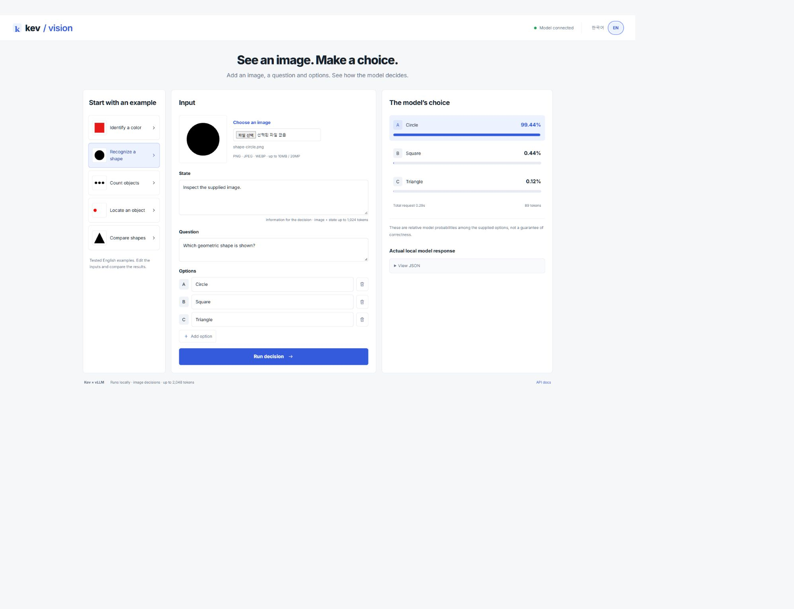

# kev-vision

**English** | [한국어](README.ko.md)

An unofficial, experimental vLLM plugin that takes an image, state, question and options, and returns option probabilities and the selected option. It does not generate chat responses. It combines the Qwen3.5 vision tower with Kev language weights and pointer head without additional training.

## Try it in the browser



After setup, double-click **`run_vision.bat`** on Windows. The model loads once,
then the browser opens at <http://127.0.0.1:18092>.
Choose an image example or upload your own PNG/JPEG/WEBP, edit the question and
options, and inspect the probabilities or copy the response JSON. The interface
supports Korean and English. Images are processed locally and are not saved by the app.

Linux: `.venv/bin/python scripts/vision_playground.py --open`.
Keep the console open; use Ctrl+C to stop. No Node build or cloud API key is needed.

[Image examples](examples/README.md) · [Playground and upload API](docs/playground.md)

## Compared with kev-vllm

| | kev-vllm | kev-vision |
| --- | --- | --- |
| Input | State, question, options | One image plus state, question, options |
| Model | Kev text backbone and pointer head | Qwen vision tower plus Kev text weights and pointer head |
| Output | Option probabilities | Option probabilities |
| Browser demo | Text decisions | Image upload and decisions |

Both are unofficial experiments. Neither generates chat responses; this repository
does not require installing the separate kev-vllm package.

## Native Windows quick start

```powershell
.\scripts\setup_kev_vision.ps1
.\run_vision.bat
```

Setup creates this repository's own **`.venv`** (Python 3.13), installs the pinned
community Windows wheel and exports FP16 weights. WSL is not required.
The wheel URL and SHA256 are in `requirements-windows.txt`; plain PyPI
`pip install vllm` is not the tested Windows installation path.

| Validated profile | vLLM | Precision | Vision attention |
| --- | --- | --- | --- |
| Windows / TITAN RTX 24 GiB / Python 3.13 | 0.29.0 community build | FP16 | TORCH_SDPA |
| Linux aarch64 / GB10 / Python 3.12 | 0.30.0 | BF16 | FLASH_ATTN |

Windows: 63 inputs × forward/reversed/singleton = **189 passing comparisons**,
12/12 synthetic images correct, and maximum reference probability error **0.104 percentage points** (rounded up).
All 13 unit/API tests passed, and all five examples passed through the real upload API.
The optional Linux font fixtures CAT/DOG were not generated on this Windows run.
These are smoke/regression results, not real-photo accuracy claims.
[Windows setup and validation](docs/windows.md).

## How it works

```text
Image + state + question + options
  → Image preprocessing and Kev input encoding
  → Qwen3.5 vision tower + Kev language model (vLLM)
  → Kev pointer head
  → Option probabilities + highest-probability option
```

The CLI corrects image orientation, preserves aspect ratio and pads with white to 256×256. It uses reference precision and eager execution: BF16/FLASH_ATTN on Linux, FP16/TORCH_SDPA on Windows. Option probabilities do not guarantee correctness or establish calibrated confidence on real photos.

## Linux setup

Validated on Linux aarch64 / NVIDIA GB10, Python 3.12, PyTorch 2.13.0 / CUDA 13.0, vLLM 0.30.0, Transformers 5.17.0 and PEFT 0.21.0. The additional Windows profile is documented above; other GPU configurations remain unvalidated.

Install `uv` and a compatible NVIDIA driver. Allow several tens of GB for downloads, the environment and caches. The merged text and vision models alone occupy approximately 7.9 GiB and 8.5 GiB. Initial preparation and CLI inference require a GPU.

```bash
git clone https://github.com/chahero/kev-vision.git
cd kev-vision
bash scripts/setup_kev_vision.sh
```

Setup creates `.venv`, downloads pinned upstream inputs, merges Kev text weights, and exports the vision model while generating synthetic fixtures. Completed model exports are reused. `pip install -e .` alone does not prepare the models.

## Run an image decision

After setup, try a generated fixture. Regenerating text references or running the full regression is not required for CLI use.

```bash
HF_HUB_OFFLINE=1 VLLM_NO_USAGE_STATS=1 OMP_NUM_THREADS=4 \
  .venv/bin/python scripts/query_kev_vision.py \
  --image artifacts/vision-experiment/images/color-red.png \
  --question "What color is the large shape?" \
  --options "Red" "Green" "Blue" \
  --output artifacts/my-result.json
```

This example selects `Red`. Replace `--image`, the question and options to use your own file. Supply at least two distinct, non-empty options. Add context with `--state "Your context"`; the default is `Inspect the supplied image.`.

Result JSON contains `selected_index` (zero-based), `selected_option`, and `options` with `text` and `probability` in input order. Console output also includes engine logs; use `--output` for a JSON file. Existing output files are overwritten. Each invocation loads a new model, so total CLI runtime exceeds the inference timings below.

Selected fields from the actual example output (probabilities can vary slightly between runs):

```json
{"selected_index": 0, "selected_option": "Red", "options": [{"text": "Red", "probability": 0.9939622}, {"text": "Green", "probability": 0.0036906}, {"text": "Blue", "probability": 0.0023471}]}
```

## Project layout

```text
kev_vision/
  __init__.py                  # vLLM plugin registration
  model.py                     # Shared pointer head and text reference model
  vision.py                    # Image-conditioned pooling model
  precision.py                 # Reference-aligned vision arithmetic
scripts/
  setup_kev_vision.sh           # Environment and model preparation
  fetch_kev_inputs.py           # Pinned upstream downloads
  prepare_kev_vllm.py           # Text weight merge used by the vision export
  experiment_vision.py          # Vision export, fixtures and reference scoring
  query_kev_vision.py           # Local image decision CLI
  kev_runtime.py               # Shared runtime settings
  validate_kev_vllm.py          # Text regression reference and checks
  test_kev_vision_vllm.py        # Image/text regression and optional timing
tests/                        # Input and precision checks
docs/                         # Final validation report and numerical evidence
```

## Linux validation commands

After setup, prepare the 27-row text reference and run image/text regression. These commands use the GPU; run them sequentially. Reproducing all 14 fixtures, including CAT/DOG, requires the system DejaVu Sans Bold font. Without it, only 12 are generated.

```bash
OMP_NUM_THREADS=4 .venv/bin/python scripts/validate_kev_vllm.py --phase reference
OMP_NUM_THREADS=4 .venv/bin/python scripts/experiment_vision.py
.venv/bin/python -m unittest discover -s tests -v
HF_HUB_OFFLINE=1 VLLM_NO_USAGE_STATS=1 OMP_NUM_THREADS=4 \
  .venv/bin/python scripts/test_kev_vision_vllm.py \
  --vision-attention FLASH_ATTN --vision-precision reference --all-singletons
```

Add `--benchmark` for cache-disabled regression and timing. The CLI selects `reference` automatically; the regression script requires it explicitly. Omitting it can fail the probability gate on the native path. Three input tests are skipped if model inputs have not been prepared.

## Linux validation and scope

- 69 inputs × forward/reversed/singleton × cache on/off: 414 comparisons passed, matching reference argmax with maximum probability error 1.50 percentage points (tolerance: 2).
- Synthetic images: 14/14 correct; blank/no-image controls: 5/14 each. The 27 text decisions matched the reference.
- Local 256px singleton latency median: 61.5 ms versus native 60.6 ms. Excludes loading, input preparation and HTTP.

Real photos/documents, varied-resolution accuracy and image probability calibration remain unverified. The local playground provides an image upload API; see its separate guide. See the validation report for exact limits and results.

`artifacts/` contains locally downloaded inputs, exported weights and generated fixtures; `.venv/` is the local environment. Both are excluded from upload. Setup downloads pinned upstream inputs. No license for this project's original code has been selected; upstream components retain their own terms.

This project does not require the separate `kev-vllm` repository or package. Helper filenames retain `kev_vllm` from extraction, but their implementations are local. Setup downloads pinned upstream Kev encoder/checkpoint source and weights; the text merge is an input to the vision export.

## Troubleshooting and limits

| Symptom | Check |
| --- | --- |
| Missing model, tokenizer or upstream source | Run `bash scripts/setup_kev_vision.sh` |
| GPU out of memory or reservation failure | Check available GPU memory and adjust `KEV_GPU_MEMORY_UTILIZATION` if needed. The tested default is `0.18`; minimum requirements on other GPUs are unverified |
| Context overflow | Shorten state, question or options. State including image: 1,024 tokens; total row: 2,048 tokens |
| Model registration or package error | Use `.venv/bin/python`; reinstall the plugin with `uv pip install --python .venv/bin/python --no-deps -e .` if needed |

The profile uses one image, one GPU, two concurrent sequences, and disables prefix caching and chunked prefill. The local playground provides an image upload API; see its separate guide. Downscaling can discard small details such as document text.

[Detailed validation](docs/validation.md) · [Upstream attribution and licenses](THIRD_PARTY.md)
