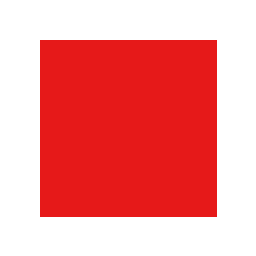
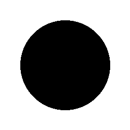
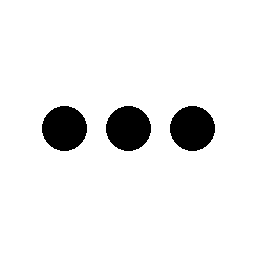
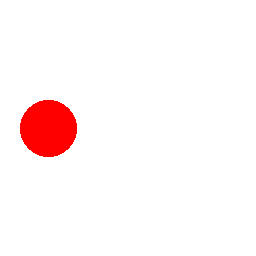
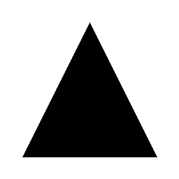

# Image examples / 이미지 예제

These are deterministic synthetic fixtures from `scripts/experiment_vision.py`.
They are test inputs, not generated UI artwork. The committed images are exactly
the files sent to the model. Results below were measured on Windows / TITAN RTX / FP16.

| Image | Question | Selected | Probability |
| --- | --- | --- | ---: |
|  | What color is the large shape? | Red | 99.38% |
|  | Which geometric shape is shown? | Circle | 99.44% |
|  | How many separate black circles are visible? | Three | 97.31% |
|  | Where is the red circle horizontally? | Left | 89.41% |
|  | Which geometric shape is shown? | Triangle | 99.65% |

Start `run_vision.bat`, then run `.venv\Scripts\python.exe examples/run_examples.py`.
On Linux use `.venv/bin/python`. Add `--output artifacts/example-results.json` to
save measured results. Expected labels are only used to check results, not sent
to the model. Five passing examples do not establish general image accuracy.

[Full API results](../docs/playground-results.json) · [Upload API guide](../docs/playground.md)
